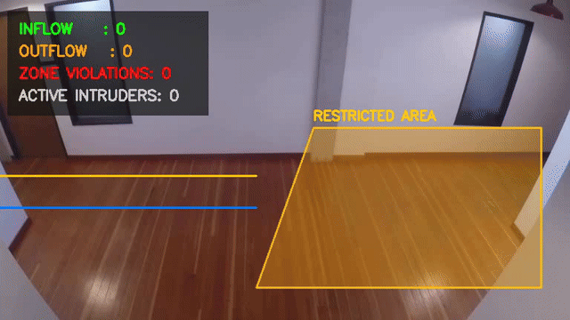

# Real-Time Smart Vision Surveillance & Geofencing System

An end-to-end computer vision pipeline for real-time pedestrian detection, multi-object tracking, directional flow estimation, and polygon geofence intrusion monitoring using **YOLOv8** and **ByteTrack**.



---

## Key Features

- **Multi-Object Tracking (MOT):** Implements ByteTrack to preserve consistent identity assignment across temporal occlusions.
- **Direction-Aware Flow Estimation:** Employs a dual-threshold virtual gate mechanism to debounce jitter and quantify bidirectional traffic (inflow vs. outflow).
- **Geometric Geofencing:** Real-time point-in-polygon verification (`cv2.pointPolygonTest`) to detect perimeter breaches within designated restricted coordinates.
- **Trajectory Vectorization:** Renders past 30-frame spatial coordinates as temporal tracking trails.
- **Dynamic Heads-Up Display (HUD):** Alpha-blended analytical dashboard displaying live occupancy, flow counts, and security violations.

---

## System Architecture

```text
Input Stream (CCTV / MP4)
       │
       ▼
 YOLOv8 Inference (Class 0: Person)
       │
       ▼
 ByteTrack Association (Kalman Filter + Hungarian Algorithm)
       ├── Trajectory Smoothing (Deque Buffer)
       ├── Bidirectional Gate Transition (Gate A <-> Gate B)
       └── Point-in-Polygon Geofence Validation
       │
       ▼
 Alpha-Blended Visual HUD & Stream Exporter
```

---

## Installation & Setup

### 1. Clone Repository
```bash
git clone [https://github.com/ErfanBateni/smart-vision-surveillance.git](https://github.com/ErfanBateni/smart-vision-surveillance.git)
cd smart-vision-surveillance
```

### 2. Configure Environment
```bash
python -m venv .venv
source .venv/bin/activate  # On Windows: .venv\Scripts\activate
pip install -r requirements.txt
```

---

## Usage

Run inference on a local video file:
```bash
python main.py --source path/to/video.mp4 --output output.mp4 --conf 0.4
```

Run real-time surveillance using an attached webcam:
```bash
python main.py --source 0 --conf 0.4
```

---

## Technology Stack

- **Framework:** Ultralytics YOLOv8
- **Tracker:** ByteTrack
- **Computer Vision:** OpenCV (cv2)
- **Scientific Computing:** NumPy, PyTorch